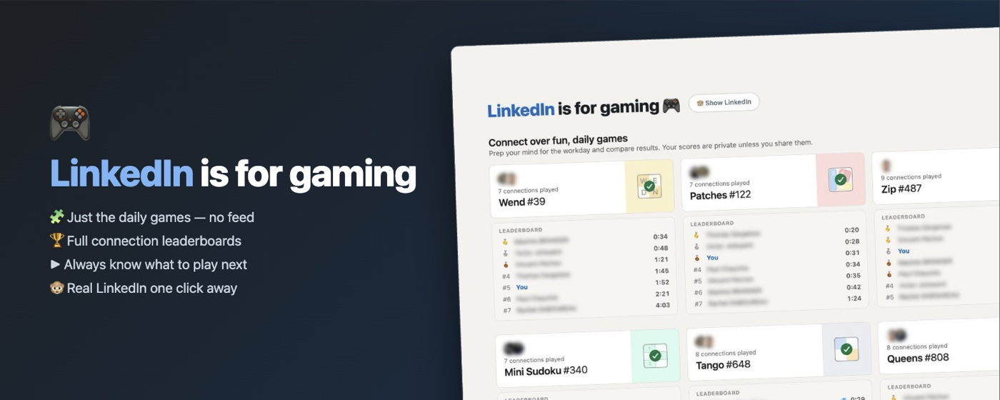

# 🎮 LinkedIn is for Gaming

LinkedIn, minus LinkedIn. Just the daily games.

**→ [Install from the Chrome Web Store](https://chromewebstore.google.com/detail/dpjdldibnlfjlladnpfdncijbilclibn)**

Two modes, toggled from the page:

**Games-only mode** (default)
- Every LinkedIn page except the games (and login) redirects to `/games/`
- Global nav, "Games" header, messaging bubble, and other chrome are stripped — plain puzzles
- Hub hero: "LinkedIn is for gaming 🎮" with a "🐵 Show LinkedIn" toggle next to it
- Full connections leaderboard (rank, names, times, 💎 flawless, top 10) under every hub card

**LinkedIn mode** ("🐵 Show LinkedIn")
- Normal LinkedIn, no redirect — but a LinkedIn-styled game bar sits on every page
  above LinkedIn's own nav: all 8 games, today's ✓ + solve time, next game in blue,
  🏆 brand when the day is cleared, and "🙈 Hide LinkedIn" to switch back
- Game pages stay plain-faced in both modes

## Install

**[Chrome Web Store](https://chromewebstore.google.com/detail/dpjdldibnlfjlladnpfdncijbilclibn/)**

Or from source:

1. Open `chrome://extensions`
2. Enable **Developer mode** (top right)
3. **Load unpacked** → select this folder

## How it works / build your own

Architecture, API details, gotchas, and how to build a similar extension: see [RECIPE.md](RECIPE.md).
